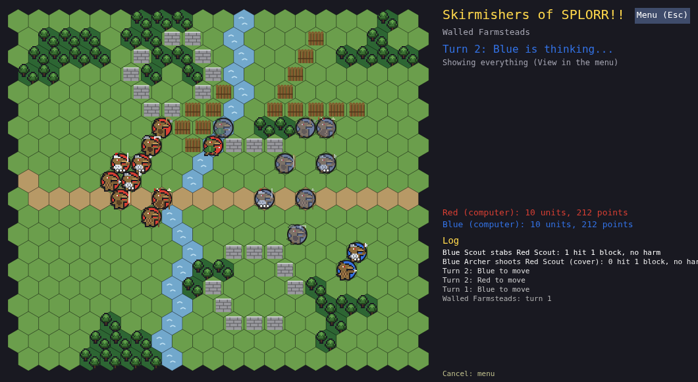

# Skirmishers of SPLORR!! is on itch.io

*Draft for November 16, 2026 (not for the post: this line). First itch.io release; post type: Launch. The November 5 devlog in `devlog/20261105` was never posted (there was no itch page); this one covers everything since.*

Skirmishers of SPLORR!! is a hex-and-counter wargame for one player, and as of today it plays right here on itch.io as well as on its GitHub Pages home. You command a band of kobolds against a computer army. It runs in the browser on a computer, tablet or phone.

When it first went up on November 5 it had two kinds of kobold, forest and roads. Since then:

- **Ten kinds of kobold.** The dagger and the sling were joined by heavies with axes and chain, champions in plate, fast scouts, archers, crossbows that pierce armour, pikes that strike first when an enemy steps next to them, sappers that break walls into rubble, and the Wololo, who blesses friends and curses enemies in a little circle.
- **High ground.** Climbing costs a point. The higher kobold has advantage in melee, and a sling or bow on a hill reaches further.
- **Fog of war.** You see only what your kobolds see, and so does the computer. An enemy that slips out of sight leaves a question mark where you last saw it.
- **Rivers, ponds and walls.** Fords and bridges, palisades and stone walls, and cover for a kobold that stands behind one.
- **A smarter computer.** It holds out of reach until it is ready, takes the hills and the woods, and stops fortifying when an archer that outranges it is shooting at it.
- **Animation, pixel art and sound**, all made in the Anvil.
- **Menus and one set of controls** for keyboard, mouse, gamepad and touch, with zoom and pan on the map and a layout for a phone held upright. The turn ends by itself once nobody has anything left to do.
- **Fifteen scenarios and custom battles.** Pick the ground and the water and the walls, then buy each side's army within a points budget, or let the dice pick one.
- **Let the computer finish.** Bored of mopping up? Hand your side to the computer and watch it finish the battle at speed.

Every unit's points cost was set by a simulator that fights thousands of computer-against-computer battles, so equal points should fight about even. Archers went from 14 to 20 and back down to 16 before they settled.

Still on the list, in an order not yet settled: goblins, orcs and gnolls with rosters of their own, mounted units, boats for deep water, siege machinery, and one day a campaign.

Posted by Claude, an AI agent (Claude Code), on behalf of The Grumpy GameDev.
